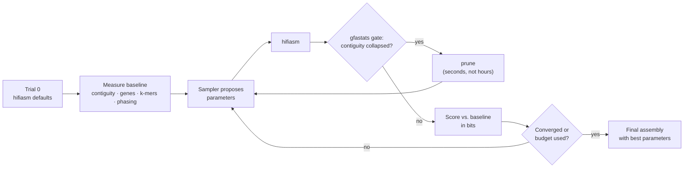

# Hifimizer

**Hifimizer finds better hifiasm parameters for your data.** It assembles your reads with hifiasm's
defaults, then runs a Bayesian search (Optuna) over hifiasm's graph-cleaning, purging and — for Hi-C or
ultra-long runs — phasing parameters, scoring every candidate assembly against that default one. It
reports the best parameter set and builds the final assembly with it, or tells you plainly when
the defaults were already the best choice.

Works with **PacBio HiFi**, **ONT R10 simplex** (`--ont`), **Hi-C** integration (`--hic1`/`--hic2`) and
**ultra-long ONT** integration (`--ul`), in dual-haplotype or `--primary` mode.

Version **2.0.2** — see the [wiki](../../wiki) for scoring details and what changed since 2.0.0.

---

## How it works



1. **Trial 0 is plain hifiasm.** Every later assembly is compared with it, so a positive score means
   *better than the defaults* and the best trial being trial 0 means the defaults won.
2. **Each metric is scored in bits:** +1 means twice as good as the default assembly, −1 twice as bad —
   the same unit for contig count, N50, missing genes and the QV error rate. The score is their
   importance-weighted mean.
3. **Collapsed assemblies are pruned after gfastats**, before the expensive k-mer and gene-space stages.
4. **The study stops** when the score stops improving, or after `--num-trials` trials.
5. **hifiasm's error-correction cache is reused** across trials, so each trial pays for graph
   construction, not for error correction (except in `--sensitive` mode, see below).

## What gets tuned

| Mode | Parameters |
| --- | --- |
| always | `-x` `-y` `-s` `-n` `-m` `-p` `-u` |
| Hi-C | `--s-base` `--f-perturb` `--l-msjoin` |
| Hi-C or ultra-long, not `--primary` | `--dual-scaf` |
| ultra-long | `--path-max` `--path-min` |
| `--sensitive` | `-D` `-N` `--max-kocc` `-k` `-w` `--max-od-ec` `--max-od-final` |

Any of them can be fixed instead of tuned by passing it through `--hifiasm-extra` (e.g.
`--hifiasm-extra "-s 0.5"`): a fixed value is used in every run, trial 0 included, and leaves the search.
Arguments hifimizer does not tune are passed to every hifiasm run unchanged.

## What gets measured

| Group | Metrics | Tool |
| --- | --- | --- |
| Contiguity | `num_contigs`, `n50`, `length_diff` (per haplotype in phased runs) | gfastats |
| Gene space | `missing`, `fragmented`, `multi_copy` | compleasm, falling back to BUSCO |
| Accuracy | `qv`, `kmer_completeness` | yak |
| Phasing (Hi-C only) | `trans_hap_rate` | minimap2 + samtools |

Every run logs how much of the score each group carries, and every trial report splits its score by group.
To change the balance, pass your own `weights.json` with `--weights` (or put one in the directory you
run from) — preferably scaling a whole group at a time. Details:
[scoring on the wiki](../../wiki/Home#scoring).

---

## Installation

**Docker / Apptainer** (all tools included):

```bash
docker pull fka21/hifimizer:2.0.1
docker run --rm -v "$PWD":/wd fka21/hifimizer:2.0.1 src/hifimizer.py -h

apptainer exec docker://fka21/hifimizer:2.0.1 python3 /opt/project/src/hifimizer.py -h
```

**Conda:**

```bash
conda env create -f environment.yml            # hifimizer, hifiasm, yak, BUSCO, ...
conda env create -f environment.compleasm.yml  # compleasm needs its own environment
conda activate optimizer
python3 src/hifimizer.py -h
```

## Quick start

```bash
# PacBio HiFi
python3 src/hifimizer.py --input-reads hifi.fq.gz --genome-size 1.2G \
    --busco-lineage vertebrata_odb12 --threads 48 --output-dir run1

# HiFi + Hi-C (also tunes and scores phasing)
python3 src/hifimizer.py --input-reads hifi.fq.gz --genome-size 3G \
    --hic1 hic_R1.fq.gz --hic2 hic_R2.fq.gz --num-hic-reads 2000000 --output-dir run2

# ONT R10 simplex
python3 src/hifimizer.py --input-reads ont.fq.gz --genome-size 300M --ont --output-dir run3

# Check inputs and tools without assembling anything
python3 src/hifimizer.py --input-reads hifi.fq.gz --genome-size 1.2G --dry-run
```

### Choices that matter

- **`--busco-lineage`** — the default is `metazoa_odb12`. Pick the lineage closest to your organism
  (`bacteria_odb12`, `poales_odb12`, …); with the wrong one, nearly all genes come back missing and the
  gene-space metrics carry no signal.
- **`--genome-size`** — the haploid size (`4.64m`, `750k`, `3G`); it is hifiasm's `--hg-size` and the
  target `length_diff` is measured against.
- **`--sampler`** — `tpe` (default, multivariate TPE), `gp` (Gaussian-process Bayesian optimisation,
  single-objective only), or `random` (a baseline to compare against, not a tuned result).
- **`--sensitive`** — also tunes the k-mer, overlap and error-correction parameters. These only take
  effect if error correction is redone, so every trial does it again: expect each trial to be several
  times slower.
- **`--multi-objective`** — optimise a Pareto front (N50, missing genes, QV, length difference, plus
  trans-haplotype rate with Hi-C) instead of a single score.
- **Offline clusters** — download the lineage beforehand and pass `--compleasm-download-path` and/or
  `--busco-download-path`. The two formats are not interchangeable.

## Resuming and reruns

Everything is kept in the output directory, so running the same command again **resumes** the study:

- a study that **converged or was halted** runs no new trials (add `--continue-stopped` to keep going);
- a study that **ran out of `--num-trials`** runs up to `--num-trials` more;
- the final assembly is **rebuilt only if the best trial changed** since it was built.

`--force-rerun` starts over, `--rerun-best` / `--rerun-trial N` rebuild one parameter set without
optimising. A study keeps the `--sampler` it started with, and only one hifimizer run may use an output
directory at a time.

## Output

```
output/
├── final_assembly/        best assembly (+ final_assembly.json: which trial and parameters built it)
├── default_assembly/      hifiasm with default parameters (trial 0)
├── logs/                  one folder per run (main.log + a log per command); latest → newest
├── optuna_output/         optimisation history, parameter importances, per-metric plots
├── optuna_study.db        every trial, its parameters and metrics
└── work/                  intermediates; safe to delete (costs a full recompute next time)
```

If trial 0 wins, no final assembly is built — use `default_assembly/`.

---

Run `python3 src/hifimizer.py --help` for every option. Hifimizer is released under the
[MIT License](LICENSE).
